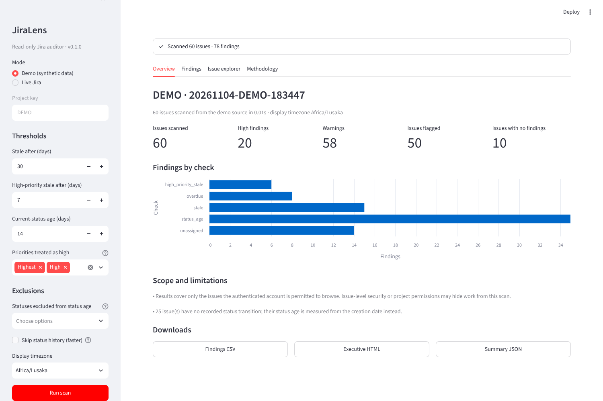
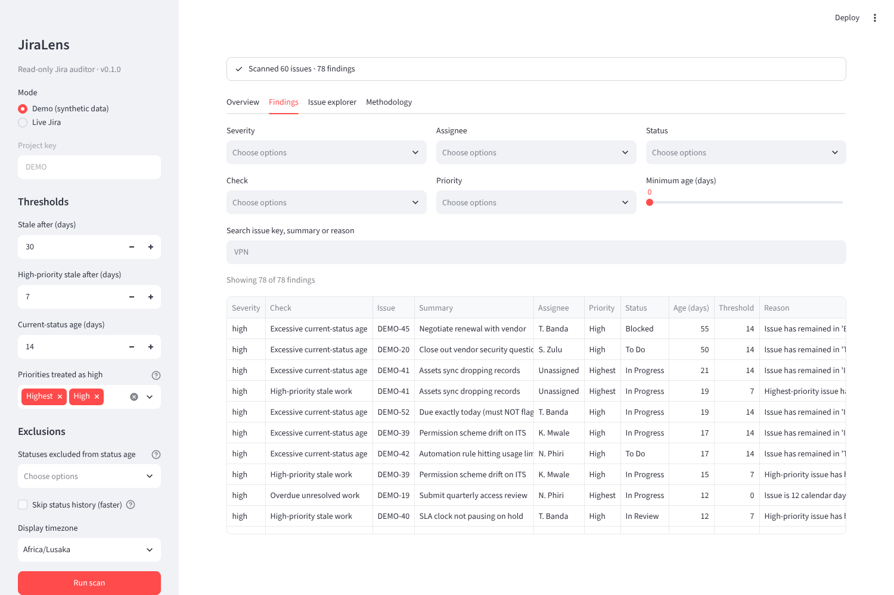
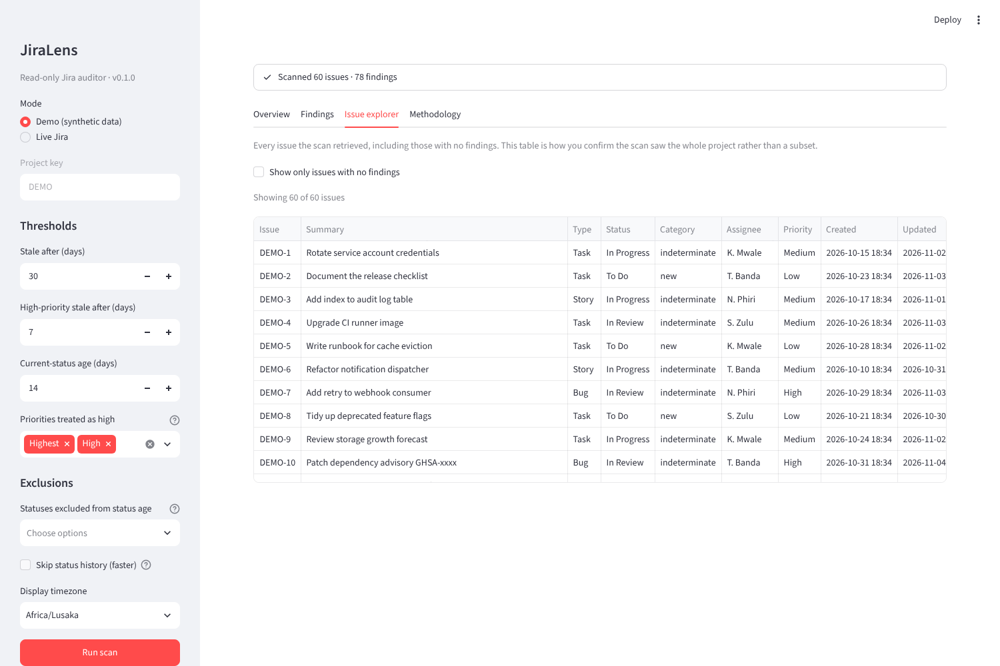
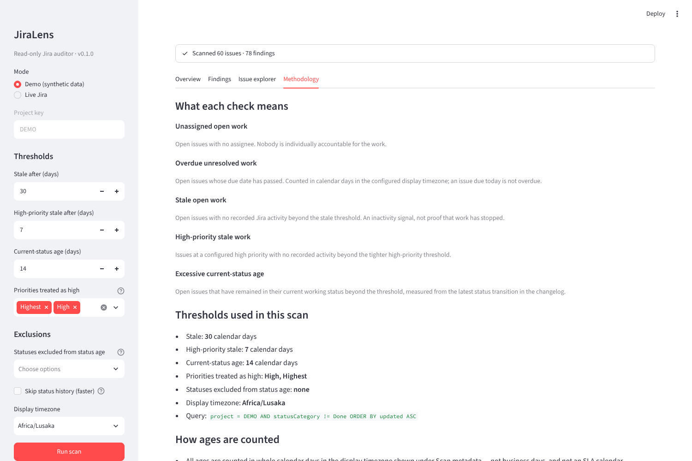

# JiraLens

A read-only Jira Cloud project health auditor for Jira administrators.

[](https://github.com/kalungakkabwe/jiralens/actions/workflows/ci.yml)

## The problem

Answering "what is actually at risk in this project?" normally means running five or
six JQL queries, pasting the results into a spreadsheet and reading them by hand —
every time, for every project. JiraLens runs those checks against a project and
returns a dashboard, a findings table and exportable reports.

It never writes to Jira. There is no create, update, transition, comment or delete
path in the codebase, and a test enforces that.

## What it checks

| Check | Rule | Default severity |
|---|---|---|
| Unassigned open work | Not Done, no assignee | Warning |
| Overdue unresolved work | Due date before today, not Done | High |
| Stale open work | No update for more than *n* days | Warning |
| High-priority stale work | Priority is high and no recent update | High |
| Excessive status age | In the same working status for more than *n* days | Warning / High |

Thresholds, high-priority names and excluded statuses are all configurable, because
Jira sites rename these freely.

## Build status

The MVP is feature-complete: live Jira scans, demo scans, all three report formats
and the dashboard all work. What remains before v0.1.0 is release mechanics — branch
ruleset, issue backlog, tag.

- **Phase 0** — packaging, validated configuration, exception hierarchy, logging with
  credential redaction, CI.
- **Phase 1** — typed domain models with an injected clock, the Jira issue normaliser,
  the `IssueSource` protocol, and a synthetic dataset of 61 issues covering every
  audit condition plus the known boundary cases.
- **Phase 2** — the five checks behind an `AuditCheck` protocol with a central registry.
- **Phase 3** — `run_scan` orchestration returning a complete `ScanResult`, with
  progress stages and honest handling of missing status history.
- **Phase 4** — CSV, JSON and HTML exporters, all driven from one `ScanResult`.
- **Phases 6 and 7** — the read-only Jira client (endpoint allowlist, retry and
  `Retry-After` handling, token pagination, bulk changelog retrieval) and the live
  issue source.
- **Phase 8** — the Streamlit dashboard: overview, filterable findings, issue
  explorer and methodology.

See `CHANGELOG.md` for what each phase pinned and why.

## Dashboard

```bash
streamlit run streamlit_app.py
```

Demo mode needs no credentials and runs the same audit engine a live scan would.



The findings table filters by severity, check, assignee, priority, status and age,
and searches issue keys, summaries and reasons. Filtering re-renders from the scan
held in session state — it never re-runs the scan or calls Jira again.



The issue explorer lists every issue the scan retrieved, including those with no
findings, which is how you confirm the scan saw the whole project rather than a
subset.



The methodology tab states what each check means, the thresholds this scan used, how
ages are counted, the limitations, and why there is no health score.



```
$ jiralens demo --exclude-status "To Do" --output reports/demo
Scan 20261104-DEMO-103000
  Issues scanned             60
  Findings                   60   (18 high, 42 warning)
  Issues with findings       47
  Issues with no findings    13

Reports written
  csv   reports/demo/20261104-DEMO-103000-findings.csv
  json  reports/demo/20261104-DEMO-103000-summary.json
  html  reports/demo/20261104-DEMO-103000-report.html
```

## Sample output

`sample_reports/` contains real output from the synthetic dataset — open
[`example-report.html`](sample_reports/example-report.html) to see the executive
report, or the CSV and JSON beside it. They are generated at a fixed instant by
`scripts/generate_sample_reports.py`, so regeneration is byte-identical and a diff
always means a deliberate change.

## Requirements

- **Python 3.12 or newer.** Check with `python3 --version` before anything else.
  macOS ships 3.9 as its system Python, and Debian/Ubuntu LTS often ship 3.10 — on
  either, install a newer Python first rather than using the system one. The
  [python.org macOS installer](https://www.python.org/downloads/macos/) is the least
  troublesome route on a Mac; it needs no compiler and no Homebrew.
- **pip 21.3 or newer.** This project uses a hatchling backend, and editable installs
  with a non-setuptools backend need PEP 660 support. An older pip fails with
  *"Directory cannot be installed in editable mode"*. The install step below upgrades
  pip first, which avoids it.

## Quick start

```bash
python3 -m venv .venv
source .venv/bin/activate
python --version
```

Confirm that prints 3.12 or newer before continuing — a venv built on an older
interpreter fails at the install step rather than here.

```bash
python -m pip install --upgrade pip
pip install -e ".[dev]"
pytest
jiralens demo
```

`jiralens demo` runs the complete audit against the bundled synthetic dataset with no
credentials, so a findings table there means the whole pipeline works.

## Live Jira mode

```bash
cp .env.example .env     # gitignored
jiralens connection-test
jiralens scan --project ITS --output reports/its
```

Create the token at
[id.atlassian.com](https://id.atlassian.com/manage-profile/security/api-tokens).
Atlassian offers two kinds, and they are **not** called the same way:

| | Classic (unscoped) | Scoped (recommended) |
|---|---|---|
| API base | your site URL | `api.atlassian.com/ex/jira/{cloudId}` |
| `JIRA_CLOUD_ID` | leave blank | required |
| Permissions | everything the account can do | only the scopes you grant |

Scoping a token to `read:jira-work` means the credential itself cannot write —
a stronger guarantee than an endpoint allowlist alone, and the one worth using.
Find your cloud ID at `https://<your-site>.atlassian.net/_edge/tenant_info`.

Mismatching the two produces a `401` that looks like a bad token, so the error
message for that case names `JIRA_CLOUD_ID` explicitly.

Tokens expire — 1 to 365 days, defaulting to a year — so a scheduled scan will
eventually stop working unless you diary the renewal.

The token is never accepted as a command-line argument, because shell history
retains it, and it is held as a `SecretStr` so it cannot surface through a `repr`,
a traceback or a logged model dump.

## Required Jira permissions

Browse Projects on each audited project. Nothing else. Findings reflect only the
issues the authenticated account is permitted to see, which every report states
explicitly.

## Design notes

Two decisions shape the codebase:

**The clock is injected.** No check ever calls `datetime.now()`. The current time
arrives as `ScanContext.now`, which makes every check a deterministic pure function
and means no test depends on the wall clock.

**`IssueSource` is a protocol.** `run_scan` depends on the protocol, not on the Jira
client, so demo mode runs the real audit engine rather than a parallel fake — and the
whole pipeline is testable with no HTTP mocking.

Status is read from `statusCategory.key` (`new` / `indeterminate` / `done`), never
from the category display name, which is localised and site-configurable.

## Known limitations

- Findings depend on the authenticated account's browse permissions.
- Calendar days, not business days or SLA calendars.
- Jira's `updated` field moves for automation and administrative events, so the stale
  check is an inactivity indicator, not proof that nobody is working on an issue.
- `POST /rest/api/3/search/jql` returns no total and paginates by token only, so the
  issue count is known once pagination completes, not before.
- No health score. A single number would depend on arbitrary weights.

## Roadmap

JSM SLA analysis · permission comparison · custom-field hygiene · sprint health ·
configuration drift.

## Licence

MIT. See `LICENSE`.
