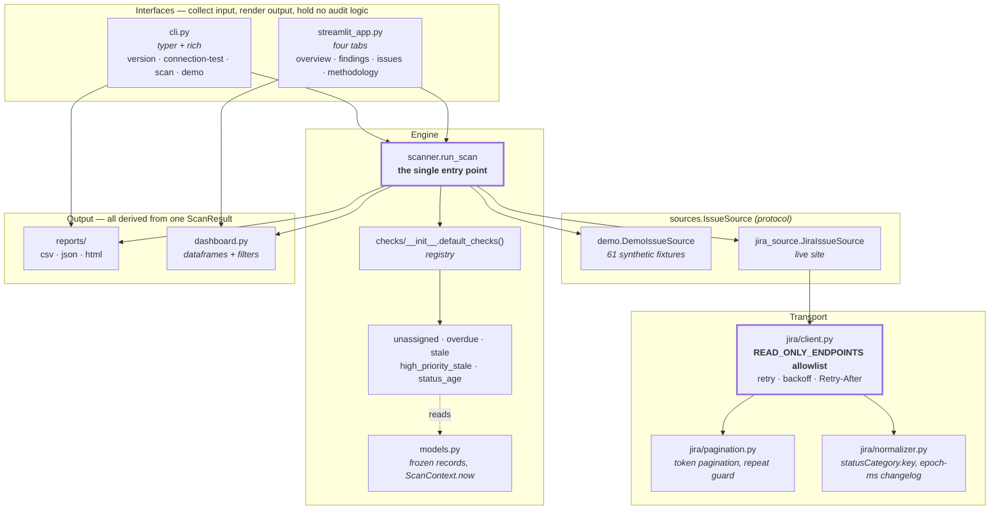
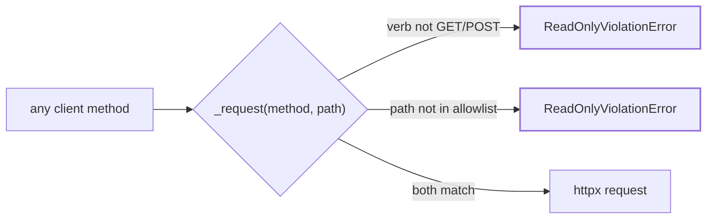
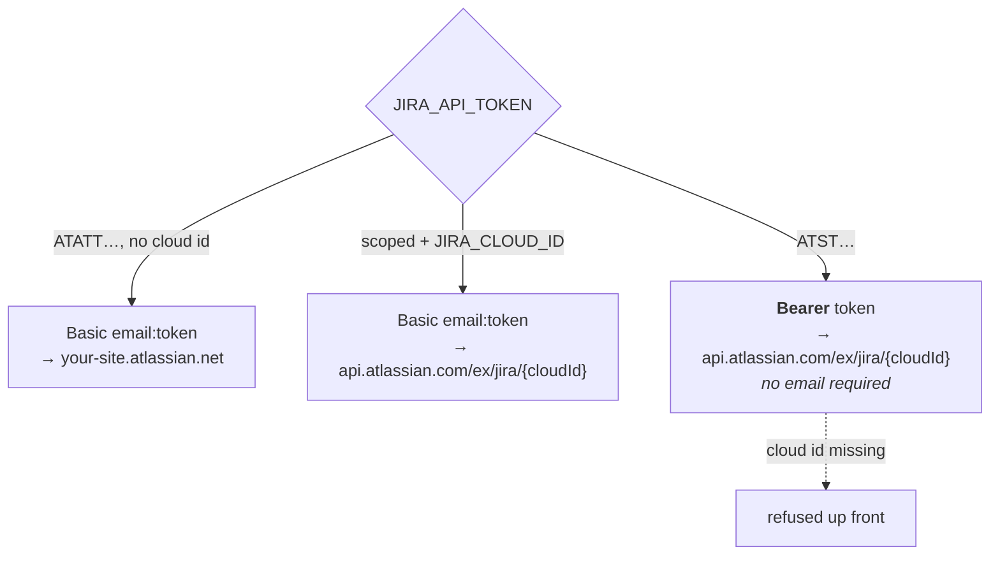

# Architecture

JiraLens is a read-only auditor. Every design decision below exists to make one of
two claims checkable: **it cannot write to Jira**, and **a finding means what the
report says it means**.

## Layers



Two edges carry the weight.

**`run_scan` depends on the `IssueSource` protocol, not on `JiraClient`.** Demo mode
therefore runs the real audit engine rather than a parallel fake, and the entire
pipeline above the transport layer is testable with no HTTP mocking at all. It is
also why the Streamlit app needed no change when live mode arrived — only
`build_source` did.

**Every HTTP request funnels through one `_request` method.** That is the chokepoint
the read-only guarantee rests on; see below.

## A live scan, end to end

```mermaid
sequenceDiagram
    autonumber
    participant U as Interface
    participant S as run_scan
    participant J as JiraIssueSource
    participant C as JiraClient
    participant A as Jira Cloud

    U->>S: ScanConfig + now
    S->>J: fetch_issues(config)
    J->>C: POST /rest/api/3/search/jql
    C->>A: page 1 (nextPageToken)
    A-->>C: issues + token
    C->>A: page 2 …
    Note over C,A: no `total` is returned — the count<br/>is known only when pagination ends
    C-->>J: raw issues
    J->>J: normalize (statusCategory.key)
    J-->>S: IssueRecord[]

    S->>J: fetch_status_history(keys)
    J->>C: POST /rest/api/3/changelog/bulkfetch
    Note over C,A: batched at the 1,000-id limit;<br/>each batch paginated, pages merged
    A-->>C: histories keyed by issue <b>id</b>
    J->>J: id → key, parse epoch-ms timestamps
    J-->>S: {key: StatusChange[]} + warnings

    S->>S: enrich current_status_since
    S->>S: run registered checks against ScanContext.now
    S-->>U: ScanResult (findings, warnings, skipped_checks)
```

Three failure modes this shape is built to survive:

- A failed changelog fetch **degrades** — the dependent check lands in
  `skipped_checks` with a warning, rather than reporting zero findings. A partial
  audit that names what is missing beats no audit, and beats a confident wrong one.
- The changelog response is keyed by issue **id**. Getting that mapping wrong would
  attach one issue's history to another and produce status ages that are wrong and
  entirely plausible, so the translation is explicit and tested.
- The latest transition is found by **timestamp**, never by list position. A
  paginated history is exactly where `changes[-1]` fails silently.

## The read-only guarantee



The allowlist holds exactly five operations:

| Verb | Path |
| --- | --- |
| GET | `/rest/api/3/myself` |
| GET | `/rest/api/3/serverInfo` |
| GET | `/rest/api/3/project/{key}` |
| POST | `/rest/api/3/search/jql` |
| POST | `/rest/api/3/changelog/bulkfetch` |

Enforced three ways, deliberately overlapping:

1. A test asserts the allowlist's **length**, so widening the surface is a visible,
   reviewable diff rather than a line nobody notices.
2. A test asserts that no `create_issue`, `update_issue`, `transition_issue`,
   `add_comment` or `delete_issue` name exists on the client's public surface.
3. A test runs a **complete scan** with catch-all routes registered for PUT, PATCH
   and DELETE, and asserts none was called. That is the actual evidence.

A scoped API token restricted to `read:jira-work` adds a fourth layer, outside the
code entirely: the credential itself cannot write. Prefer it where the site offers it.

## Authentication paths

Three token families reach Jira three different ways, and sending one down the wrong
path returns a 401 that reads exactly like a typo.



The **site URL and the API base URL are separate values** throughout. Issue links in
every report are built from the site URL — building them from the gateway would
produce a dead link under every finding.

## Determinism

No check calls `datetime.now()`. The scan instant arrives as `ScanContext.now`,
injected from the interface layer. Every check is therefore a pure function of
`(issues, context)`, every test is independent of the wall clock, and two scans of
the same data at the same logical instant are byte-identical — which is what makes
`scripts/generate_sample_reports.py` reproducible and CI-verifiable.

The same property is what lets the Streamlit app hold a completed `ScanResult` in
session state: changing a filter re-renders from memory and never re-runs the scan
or calls Jira again.

## What deliberately does not exist

- **No health score.** One number would need arbitrary weights, and nobody could act
  on it. Findings name the issue, the rule and the threshold.
- **No persisted state.** No database, no scan history, no scheduler. A scan is a
  pure function of the site and the config; reports are the artefact.
- **No write path.** Not disabled, not feature-flagged — absent, and asserted absent.
